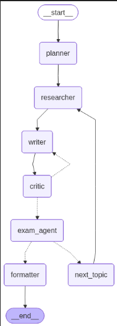

# NoteForge-AI

NoteForge-AI is a multi-agent AI system that converts a syllabus into structured, exam-ready notes with unit-level questions and PDF export.<br>

https://noteforge-ai-lingesh.streamlit.app/
---

## 🧠 Overview

The system uses an agent-based workflow to:

```text
- Break syllabus into topics
- Retrieve relevant content (PDF or web)
- Generate structured notes
- Refine output using a critic loop
- Produce final notes with important questions
```

---

## 🏗️ Architecture

<p align="center">
  
</p>

---

## ✨ Features

```text
- Multi-agent pipeline (LangGraph)
- Works with:
    - Uploaded PDF (RAG)
    - Web fallback (Tavily)
- Self-improving notes using critic loop
- Structured, exam-oriented output
- Unit-level important questions
- PDF generation
- Caching for faster runs
```

---

## 🛠️ Installation

```bash
git clone https://github.com/Lingesh-7/NoteForge-AI.git
cd NoteForge-AI
pip install -r requirements.txt
```

---

## 🔐 Keys

| Key | Who provides it | Where it goes |
|---|---|---|
| OpenRouter API key | Each visitor | Pasted into the app sidebar. Used for that session only, never stored. |
| `TAVILY_API_KEY` | The app owner (optional) | `.env` in the project root. |

Without `TAVILY_API_KEY` the app still runs: notes come from an uploaded book PDF, or from the model's own knowledge if there is no PDF.

Create `.env` in the root directory:

```env
TAVILY_API_KEY=your_api_key
```

> ⚠️ **Important:** Never commit `.env`. It is in `.gitignore`.
>
> The app reads keys from environment variables only (`.env` is loaded into them at startup); it does not use `secrets.toml`. Because `.env` is not in the repo, a hosted copy needs the same variable set in the host's environment. On Streamlit Cloud, the lines pasted into **Settings > Secrets** are exposed to the app as environment variables, so no code change is needed.

---

## ▶️ Usage

```bash
streamlit run app.py
```

---

## ☁️ Deploy on Streamlit Community Cloud

```text
1. Push the repo to GitHub.
2. On share.streamlit.io choose New app, pick the repo, branch main, file app.py.
3. Under Advanced settings choose Python 3.13 and paste into Secrets:
       TAVILY_API_KEY = "tvly-..."
4. Deploy.
```

Streamlit Cloud installs from `uv.lock`, which pins CPU-only PyTorch on Linux. To change a dependency, edit `pyproject.toml`, run `uv lock`, mirror the change in `requirements.txt`, and commit all three.

---

## 🔄 Steps

```text
1. Paste your free OpenRouter API key (the app shows how to get one)
2. Paste the syllabus, one topic per line
3. Upload the textbook PDF (optional)
4. Click Generate notes and follow the per-topic progress
5. Download the PDF or Markdown

The in-app Guide tab covers getting keys, writing a good syllabus and troubleshooting.
```

---

## 📁 Project Structure

```bash
.
├── app.py
├── graph/
│   ├── nodes.py
│   ├── graph_builder.py
│   └── state.py
├── prompts/
├── rag/
├── utils/
├── fonts/
├── .streamlit/
│   └── config.toml
├── pyproject.toml
├── uv.lock
├── requirements.txt
└── README.md
```

---

## ⚠️ Limitations

```text
- API rate limits may interrupt generation
- Large inputs increase latency
- Output quality depends on source quality
```

---

## 🚀 Roadmap

```text
[ ] Better PDF styling & formatting
[ ] Semantic caching (vector reuse)
[ ] Export to DOCX / Markdown
[ ] Fast vs High-Quality mode
[ ] Evaluation metrics for generated notes
```

---

## 🤝 Contributing

```text
Contributions, improvements, and ideas are welcome.
Feel free to open issues or submit pull requests.
```

---

## 📜 License

```text
MIT License
```

---

## 💡 Motivation

```text
Students spend hours converting scattered syllabus content into structured notes.
NoteForge-AI automates that entire workflow intelligently.
```

---

## ⭐ Support

```text
If you find this project useful, consider giving it a star ⭐
```
